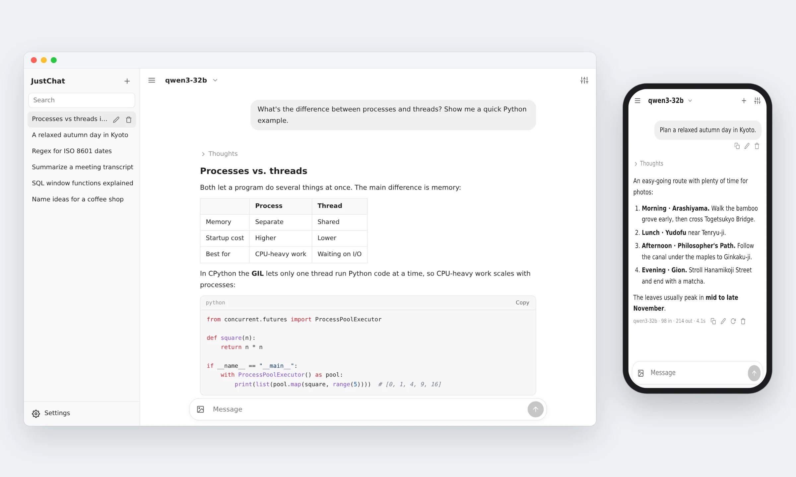

# JustChat

**A lightweight chat client for large language models, in a single HTML file.**

Open it in a browser, add your API, and start chatting. No build step, no dependencies, no sign-up. Your chats and keys stay on your device.

  

**English** · [简体中文](README.zh-CN.md)

<picture>
  <source media="(prefers-color-scheme: dark)" srcset="docs/preview-dark.webp">
  
</picture>

## Features

<table>
  <tr>
    <td width="50%" valign="top"><b>🔌 Bring your own models</b> Any OpenAI-compatible API (OpenAI, DeepSeek, OpenRouter, Ollama, vLLM, LM Studio, …) and the Anthropic API. Add as many providers as you like and switch models per chat.</td>
    <td width="50%" valign="top"><b>💬 Made for conversation</b> Streaming replies, visible reasoning, Markdown with tables and highlighted code, image input, and editing or regenerating any message.</td>
  </tr>
  <tr>
    <td width="50%" valign="top"><b>🎛️ Your settings, per chat</b> System prompt, temperature, top P, max tokens, context length, reasoning effort and streaming, for each chat or as defaults.</td>
    <td width="50%" valign="top"><b>🔒 Private</b> Everything is stored in your browser. No analytics, no account, no third-party server. Back up with JSON export and import.</td>
  </tr>
  <tr>
    <td width="50%" valign="top"><b>📱 Everywhere</b> Desktop and phone layouts, light and dark themes, English and Chinese, and Add to Home Screen.</td>
    <td width="50%" valign="top"><b>🪶 Tiny</b> One HTML file of about 110 KB. Open it from disk or host it anywhere.</td>
  </tr>
</table>

## Quick start

1. **Get the file.** Download [`index.html`](index.html) and open it in your browser, or put it on any static host such as GitHub Pages or Nginx.
2. **Add a provider.** Click **Add provider**, enter the base URL and API key, then press **Fetch list** to load the models.
3. **Start chatting.** Pick a model in the top bar and send a message.

> [!NOTE]
> Each browser keeps its own chats and settings, so the same page can be used on several devices without them mixing. To back up or move them, use **Settings → Data → Export**.

> [!TIP]
> On a phone, use **Add to Home Screen** to open JustChat like an app.

### Base URLs

| Service | API format | Base URL |
| --- | --- | --- |
| OpenAI | OpenAI compatible | `https://api.openai.com/v1` |
| Anthropic | Anthropic | `https://api.anthropic.com` |
| DeepSeek | OpenAI compatible | `https://api.deepseek.com` |
| OpenRouter | OpenAI compatible | `https://openrouter.ai/api/v1` |
| Ollama | OpenAI compatible | `http://localhost:11434/v1` |
| vLLM, SGLang, llama.cpp, LM Studio | OpenAI compatible | `http://<host>:<port>/v1` |

JustChat adds the endpoint path for you (`/chat/completions`, or `/v1/messages` for Anthropic), and the provider dialog shows the final address. A full endpoint URL works too.

## Configuration

### Chat settings

Open them with the sliders icon in the top bar. Blank fields aren't sent, so the provider's own defaults apply. **Save as default** applies the settings to new chats as well, and the model you pick in the top bar becomes the default for new chats.

| Setting | What it does |
| --- | --- |
| System prompt | Instructions sent with every request in the chat. |
| Temperature, Top P | Sampling parameters. Some newer models reject them; leave them blank for those. |
| Max tokens | Longest reply allowed. Blank uses the provider's default; for Anthropic, which requires a value, it's 8192. |
| Context messages | How many recent messages are sent with each request. Blank sends the whole chat. |
| Reasoning effort | `reasoning_effort` for OpenAI-compatible APIs, adaptive thinking with an effort level for Anthropic. |
| Stream output | Show the reply as it's generated. |

### Provider options

Under **Advanced** in the provider dialog you can add extra headers and extra body parameters (JSON) that go with every request to that provider:

| Example | Use |
| --- | --- |
| `{"top_k": 20, "repetition_penalty": 1.05}` | Extra sampling options of self-hosted servers |
| `{"chat_template_kwargs": {"enable_thinking": false}}` | Turn off thinking on some vLLM and SGLang models |
| `{"stream_options": {"include_usage": true}}` | Show token counts with OpenAI-compatible streaming |
| `{"thinking": {"type": "enabled", "budget_tokens": 4096}}` | Thinking budget for Anthropic-compatible servers |
| `{"api-key": "…"}` (headers) | Gateways that don't use `Authorization: Bearer` |

## Keyboard shortcuts

| Keys | Action |
| --- | --- |
| <kbd>Enter</kbd> | Send (a new line on touch screens) |
| <kbd>Shift</kbd> + <kbd>Enter</kbd> | New line |
| <kbd>Ctrl</kbd> / <kbd>⌘</kbd> + <kbd>Enter</kbd> | Send. Can be made the only send key in Settings. |
| <kbd>Esc</kbd> | Stop generating |

While editing a message, <kbd>Ctrl</kbd> / <kbd>⌘</kbd> + <kbd>Enter</kbd> saves and <kbd>Esc</kbd> cancels.

## Privacy

- Chats and settings, API keys included, are stored only in your browser (IndexedDB). Host JustChat on its own domain or subdomain, because other pages on the same origin could read them.
- JustChat only talks to the APIs you add. Images in model replies are loaded from their URLs.
- Exports contain everything, API keys included.
- Browsers may clear data of sites you haven't used for a while, Safari especially. Export now and then; on iOS, adding the page to the Home Screen helps.

## Development

Everything lives in `index.html`: the styles, the markup and one script organized in sections (utilities, i18n, storage, Markdown, API, UI). There is nothing to install or build. Edit the file and reload.

To add a UI language, add an entry to the `I18N` object and an option to the language select.

## License

[MIT](LICENSE)
