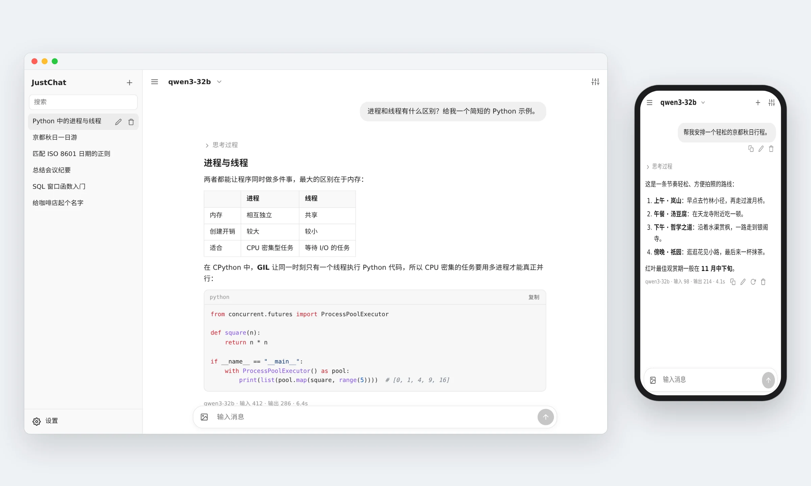

# JustChat

**一个轻量的大模型聊天客户端，只有一个 HTML 文件。**

用浏览器打开，填上你的 API，就能开始对话。 无需构建、没有依赖、不用注册。对话记录和 API Key 只留在你自己的设备上。

  

[English](README.md) · **简体中文**

<picture>
  <source media="(prefers-color-scheme: dark)" srcset="docs/preview-dark-zh.webp">
  
</picture>

## 功能特性

<table>
  <tr>
    <td width="50%" valign="top"><b>🔌 接入你自己的模型</b> 支持所有 OpenAI 兼容 API（OpenAI、DeepSeek、OpenRouter、Ollama、vLLM、LM Studio 等）和 Anthropic API。可以添加任意多个服务商，每个对话单独选择模型。</td>
    <td width="50%" valign="top"><b>💬 专注对话</b> 流式输出、显示推理过程（推理强度在输入框旁边调整）、支持表格和代码高亮的 Markdown，任意消息都能编辑或重新生成。</td>
  </tr>
  <tr>
    <td width="50%" valign="top"><b>📎 图片和文档</b> 可以添加图片、PDF、Word、Excel、PowerPoint 和文本文件。文档在浏览器里读取，以文字形式发送，任何模型都能用。</td>
    <td width="50%" valign="top"><b>🌐 联网搜索</b> 模型可以搜索网页、读取网页和 PDF，回答时附上来源链接。支持工具调用的模型都能用。</td>
  </tr>
  <tr>
    <td width="50%" valign="top"><b>🎛️ 每个对话单独设置</b> 系统提示词、温度、Top P、最大输出 Token、上下文消息数、流式输出，可以按对话设置，也可以设为默认。</td>
    <td width="50%" valign="top"><b>🔒 保护隐私</b> 所有数据都保存在你的浏览器里。没有统计、不用账号、不经过第三方服务器。支持 JSON 导出和导入备份。</td>
  </tr>
  <tr>
    <td width="50%" valign="top"><b>📱 随处可用</b> 适配电脑和手机，浅色 / 深色主题，中英文界面，可以添加到手机主屏幕。</td>
    <td width="50%" valign="top"><b>🪶 小巧</b> 只有一个约 175 KB 的 HTML 文件。可以直接打开本地文件，也可以放到任何地方托管。</td>
  </tr>
</table>

## 快速开始

1. **获取文件。** 下载 [`index.html`](index.html) 用浏览器打开，或者放到任意静态托管上，比如 GitHub Pages、Nginx。
2. **添加服务商。** 点击 **添加服务商**，填写 Base URL 和 API Key，再点 **获取列表** 拉取模型。
3. **开始对话。** 在顶栏选择模型，发送消息即可。每次打开都是一个新对话，之前的对话在侧边栏里。

> [!NOTE]
> 每个浏览器各自保存自己的对话和设置，多台设备访问同一个页面也互不干扰。需要备份或迁移时，使用 **设置 → 数据 → 导出**。

> [!TIP]
> 在手机上可以 **添加到主屏幕**，像 App 一样打开 JustChat。

### Base URL 示例

| 服务 | API 格式 | Base URL |
| --- | --- | --- |
| OpenAI | OpenAI 兼容 | `https://api.openai.com/v1` |
| Anthropic | Anthropic | `https://api.anthropic.com` |
| DeepSeek | OpenAI 兼容 | `https://api.deepseek.com` |
| OpenRouter | OpenAI 兼容 | `https://openrouter.ai/api/v1` |
| Ollama | OpenAI 兼容 | `http://localhost:11434/v1` |
| vLLM、SGLang、llama.cpp、LM Studio | OpenAI 兼容 | `http://<主机>:<端口>/v1` |

JustChat 会自动补上接口路径（`/chat/completions`，Anthropic 格式为 `/v1/messages`），服务商对话框里会显示最终的请求地址。直接填写完整的接口地址也可以。

## 图片和文档

点击输入框下方的按钮添加文件，也可以直接把文件拖到对话区域，或者粘贴进来。

- **图片** 作为图片输入发给模型，需要模型支持视觉。较大的图片会缩小到 2048 像素以内。
- **文档** 在浏览器里读取，提取出的文字随消息一起发送，所以任何模型都能用。点击已添加的文件，可以查看模型收到的文字。

| 类型 | 读取的内容 |
| --- | --- |
| PDF | 文字层，按页读取 |
| Word（`.docx`） | 段落、标题、列表和表格 |
| Excel（`.xlsx`） | 所有工作表的每一行单元格，日期和百分比会转换成可读的形式 |
| PowerPoint（`.pptx`） | 按顺序读取每页幻灯片的文字 |
| 文本 | Markdown、CSV、JSON、HTML、源代码等纯文本文件（UTF-8、UTF-16 或 GBK 编码） |

扫描版 PDF（没有文字层）和加密的 PDF 无法读取；旧版的 `.doc`、`.xls`、`.ppt` 文件需要先另存为新格式。每个文件最大 30 MB。很长的文档会占用模型大量的上下文。

## 联网搜索

打开输入框下方的 **联网**，模型回答时就可以自己查资料：

- `web_search`：用你在 **设置 → 联网** 里选的服务搜索，支持 Tavily、Jina、Serper（Google 结果）、博查、智谱，需要填写对应服务的 API Key。
- `web_fetch`：读取网页、PDF 等在线文档。网页通过 Jina Reader 读取，不填 Key 也能用（有频率限制）；搜索服务选 Tavily 时改用 Tavily 读取。不设置搜索服务时，模型仍然可以读取你发来的链接。

回答里会列出模型搜了什么、读了哪些网页，并附上来源链接。这个开关按对话保存，新对话沿用你上一次的选择。

模型需要支持工具调用，目前大多数模型都支持；自己部署的 vLLM 需要加上 `--enable-auto-tool-choice` 和对应模型的 `--tool-call-parser` 参数。不支持工具调用的模型，会先拿你的消息去搜索，再把结果交给模型回答。需要登录才能看的网页读取不了，很长的网页会截短后再交给模型。

## 配置说明

### 推理强度

输入框旁边的 💡 按钮用来设置模型回答前思考的程度。可选的等级取决于当前对话所用模型的 API 格式：

| API 格式 | 等级 | 发送方式 |
| --- | --- | --- |
| OpenAI 兼容 | 关闭、最少、低、中、高、超高 | `reasoning_effort` |
| Anthropic | 低、中、高、超高、最高 | 带强度等级的自适应思考 |

选择 **默认** 时不发送这个参数，由模型自己决定。你选的等级也会成为新对话的默认值。如果模型不接受这个参数，改回默认即可。

### 对话设置

点击顶栏的滑块图标打开。留空的字段不会发送，即使用服务商自己的默认值。**设为默认** 会让之后的新对话也使用这些设置；在顶栏选择的模型也会成为新对话的默认模型。

| 设置 | 作用 |
| --- | --- |
| 系统提示词 | 这个对话中每次请求都会附带的指令。 |
| 温度、Top P | 采样参数。部分较新的模型不接受这些参数，使用时请留空。 |
| 最大输出 Token | 回复的最大长度。留空则使用服务商的默认值；Anthropic 格式要求必须填写，留空时为 8192。 |
| 上下文消息数 | 每次请求附带的最近消息条数。留空则发送整个对话。 |
| 流式输出 | 边生成边显示回复。 |

### 服务商高级选项

在服务商对话框的 **高级** 中，可以填写额外的请求头和请求参数（JSON），它们会随每个请求一起发往该服务商：

| 示例 | 用途 |
| --- | --- |
| `{"top_k": 20, "repetition_penalty": 1.05}` | 自部署服务支持的其他采样参数 |
| `{"chat_template_kwargs": {"enable_thinking": false}}` | 在部分 vLLM、SGLang 模型上关闭思考 |
| `{"stream_options": {"include_usage": true}}` | 让 OpenAI 兼容的流式输出返回 Token 用量 |
| `{"thinking": {"type": "enabled", "budget_tokens": 4096}}` | 为 Anthropic 兼容服务设置思考预算 |
| `{"api-key": "…"}`（请求头） | 不使用 `Authorization: Bearer` 的网关 |

## 快捷键

| 按键 | 作用 |
| --- | --- |
| <kbd>Enter</kbd> | 发送（触屏设备上为换行） |
| <kbd>Shift</kbd> + <kbd>Enter</kbd> | 换行 |
| <kbd>Ctrl</kbd> / <kbd>⌘</kbd> + <kbd>Enter</kbd> | 发送。可以在设置中改为只用这个组合键发送。 |
| <kbd>Esc</kbd> | 停止生成 |

编辑消息时，<kbd>Ctrl</kbd> / <kbd>⌘</kbd> + <kbd>Enter</kbd> 保存，<kbd>Esc</kbd> 取消。

## 隐私

- 对话和设置（包括 API Key）只保存在你的浏览器里（IndexedDB）。同一来源下的其他网页也能读到这些数据，所以建议把 JustChat 放在单独的域名或子域名下。
- JustChat 只会访问你添加的 API。模型回复中的图片会从对应地址加载。
- 添加的文件在浏览器里读取，作为消息的一部分发给 API，文档以纯文字形式发送。文件内容会随对话保存，导出时也会包含在内。
- 开启联网后，搜索词会发给你选择的搜索服务，模型读取的网页通过 Jina Reader 或 Tavily 获取。
- 导出的文件包含全部数据，也包括 API Key。
- 浏览器可能会清除长时间未访问网站的数据，Safari 尤其如此。建议定期导出备份；在 iOS 上添加到主屏幕也有帮助。

## 开发

所有内容都在 `index.html` 里：样式、页面结构，以及按模块划分的一段脚本（工具函数、多语言、存储、Markdown、API、联网、文档读取、界面）。无需安装或构建，修改后刷新即可。

如需添加界面语言，在 `I18N` 对象中加一项，并在语言下拉框中加一个选项。

## 许可证

[MIT](LICENSE)
